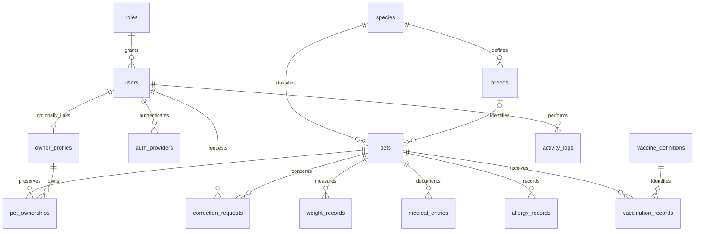

# PetFave database design (stage 1)

The production database is MySQL 8+. Tests use isolated SQLite databases. No existing database is reset during installation.

Each pet has exactly one current ownership, identified by its current_ownership_id foreign key. Previous ownership rows have ended_at. Transfers lock the pet and atomically close the old ownership and select a new ownership. Only administrators may transfer with a verification reference. The new owner can see all pet health history; former owners immediately lose all pet access. Clients never receive ownership history or former owner details. Health records contain no owner contact information. A composite foreign key ensures the current ownership belongs to the same pet.

Owner profiles hold name, contact number and address even without a user account. A unique nullable user_id links at most one account after administrator verification. Users hold login identity and role; the linked owner's contact details are the canonical client contact data. Unlinked users (staff or incomplete registrations) have account contact fields. When linking, profile contact data becomes canonical; the redundant user contact fields are cleared. Linking is never performed by matching email alone.

Species, breeds, roles and vaccine definitions are reference entities. Breed is nullable (mixed/unknown is represented by breed_description); a composite foreign key and validation enforce species/breed consistency. Birth date is either exact or estimated; age is calculated at read time. Pet allergy_information_status distinguishes unknown from no known allergies and recorded allergies. Weight is derived from the latest measurement (date, then ID), never copied onto the pet.

Clinical tables each have pet_id and recorded_by foreign keys, dates, notes and timestamps. They have no normal delete routes. Updates and administrative changes write immutable activity logs containing actor, action, timestamp and relevant before/after values in the same transaction. Audit JSON is an event snapshot, not a second source of current clinical data. Archive status is reversible and leaves all relationships intact.

Correction requests have a required pet_id, target_type and nullable foreign keys for weight_record_id, medical_entry_id, allergy_record_id, vaccination_record_id or pet_ownership_id. Exactly one matching foreign key is required by a database CHECK constraint and Form Request validation; the target must belong to the selected pet. Resolution requires an administrator, a reason, and a timestamp. Accepted corrections can apply validated target-field changes atomically with resolution and audit logging. Former owners' request content is never disclosed to the new owner.

3NF: every entity uses a single primary key; fields are atomic (1NF); all non-key fields depend on the whole key (2NF); role labels, breed/species names, vaccine names and owner contact information live only in their own entities (3NF). Relationships use foreign keys rather than lists of IDs. Unique keys protect email, provider subject, user-to-owner links and reference names. Indexed ownerships, pet names, dates, statuses and foreign keys support searches. Health history is not copied when ownership changes.

Role permissions are granted centrally by the role reference (administrator, staff, client), with server-side role gates and per-pet ownership authorization. Administrators may change an account role/status with an audit reason; public registration only accepts staff/client. Pending, rejected, disabled or incomplete accounts cannot enter business APIs. All normal business endpoints use /api/v1.
